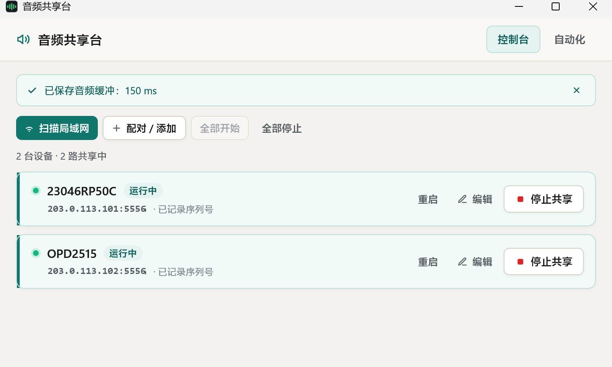

# AudioHub 音频共享台

在安卓手机或平板上看视频，用 Windows 的音箱或耳机听声音。桌面控制台使用 Rust + GPUI，同一局域网内每台设备独立运行一个 scrcpy 纯音频会话，由 Windows 混音。安卓端使用系统的无线调试，无需安装配套 App。



## 下载和运行

1. 在 [GitHub Releases](https://github.com/heloka/AudioHub/releases/latest) 下载最新的 `AudioHub-v*-windows-x64.zip` 并解压。
2. 下载 [官方 scrcpy 3.1 Windows x64 压缩包](https://github.com/Genymobile/scrcpy/releases/tag/v3.1)，将解压后的 `scrcpy-win64-v3.1` 文件夹放到 `AudioHub` 文件夹旁边。保留 scrcpy 发行包中的所有文件。
3. 双击 `AudioHub\audiohub.exe`。按下文配对第一台设备，随后在控制台点「开始共享」。

```text
任意可写目录/
├── AudioHub/
│   └── audiohub.exe
└── scrcpy-win64-v3.1/
    ├── adb.exe
    ├── scrcpy.exe
    └── 其余发行文件
```

如果已在使用 AudioHub，先退出旧版再运行新版。也可以把同一套发行包中的工具设到 PATH。

如果 Windows 提示缺少 `VCRUNTIME140.dll`，请安装 [Microsoft Visual C++ v14 Redistributable（x64）](https://learn.microsoft.com/zh-cn/cpp/windows/latest-supported-vc-redist#latest-supported-redistributable-version)。

## 首次无线配对与重启

安卓 11 及以上的手机和平板，在开发者选项中打开「无线调试」，让设备与电脑接入同一局域网。在平板上选择「使用配对码配对设备」，在 AudioHub 用配对地址和六位配对码完成配对。随后选用无线调试主页的**连接地址**或扫描到的连接服务开始共享。配对弹窗中的端口仅用于配对。

首次成功连接后，AudioHub 会记下能读取到的设备序列号。平板重启后，「开始共享」会尝试恢复连接。平板若弹出授权对话框，请在设备上确认；若无线调试已关闭，请重新打开。局域网需要允许 mDNS 才能自动发现新地址。无法发现时可按无线调试主页提供的地址手动添加。首次迁移且旧地址已经失效的设备，也可这样重新选定。

历史 `IP:5556` 在仍有效时可以继续使用。如果固定端口失效，恢复共享时会尝试已授权的原生无线调试连接，并再次核对设备序列号。系统关闭全部无线调试入口时，需要在平板上操作。Android 11 的部分设备在启动采音时还需要解锁屏幕。

## 控制台与自动化

- **控制台**可以直接扫描、添加、配对设备，逐台开始、停止或重启共享，也可以控制全部设备。
- **自动化**集中显示扫描结果和运行日志。启动后默认定时通过 mDNS 查找同一局域网内公布的 ADB 连接与配对服务，也列出当前 ADB 已连接的无线设备。能验证序列号的已授权设备可以自动入列；共享默认手动开始。网络阻止组播广播时仍可手动填写地址。
- 想沿用原版「下次打开继续播放」，可开启恢复上次共享。需要排查连接问题时，在自动化页查看发现、授权、重连和音频会话记录。
- 插线恢复适用于已记录序列号的设备。启用后，将平板接入同一 Wi-Fi 并通过已授权的 USB 连接电脑，可恢复固定端口 5556。固定端口兼容选项适用于会自行关闭无线调试的平板，开启后在建立共享时尝试切到 5556，并在确认设备身份后更新地址。两项默认关闭。

## 视频与音频输出

多台设备同时共享时，默认每路使用独立的电脑端转发端口。控制台在 Windows 为该路播放器建立活动音频会话后显示「运行中」。等待播放端超过 20 秒会单独重连该路；视频暂停、片段静音时不会因为没有音量而重连。

旧配置的音频参数会沿用，包括原先的 300 ms 缓冲。新配置默认 100 ms。对白比口型慢时，可比较较小缓冲；声音出现爆音或断续时再调高。缓冲值仅是链路的一部分，同一平板使用电脑音箱和蓝牙耳机时可感受到不同延迟。Windows 输出设备变化后，控制台会重新启动进行中的音频流。

## 配置与构建

首次使用会读取原有 `devices.json` 的设备列表与音频参数。之后的变更保存到 `audiohub.json`，旧版可继续单独使用原来的配置。调试连接和 scrcpy 子进程共用本机专用 ADB 端口 5038。

从源码构建需要 Windows x64、Rust stable MSVC、Visual Studio C++ Build Tools 和包含 `fxc.exe` 的 Windows SDK。运行 `build.cmd` 会生成项目根目录的 `audiohub.exe`。在已配置同样工具链的开发者命令提示符中可运行 `cargo test --locked`。如果 SDK 编译器不在 PATH，可将 `GPUI_FXC_PATH` 设为 `fxc.exe` 的完整路径。

## 实机验证

已实测 Windows x64 下小米平板与 OPPO Pad mini 同时播放。开启「启动时恢复共享」后，也已验证重启电脑并打开 AudioHub 时，两台设备能自动恢复连接。其他设备的无线配对和采音行为会受到 Android 版本及厂商系统影响。

[AudioHub 许可证](LICENSE) · [第三方组件](THIRD_PARTY_NOTICES.md) · [Android 无线调试说明](https://developer.android.com/tools/adb#wireless)
